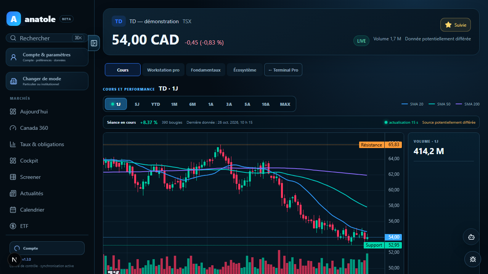
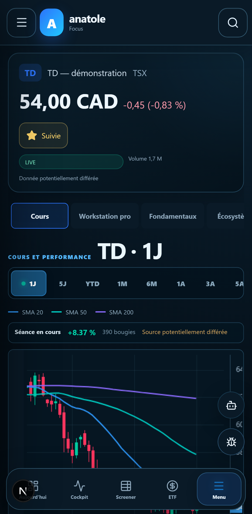
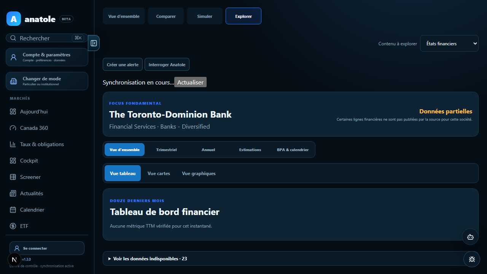
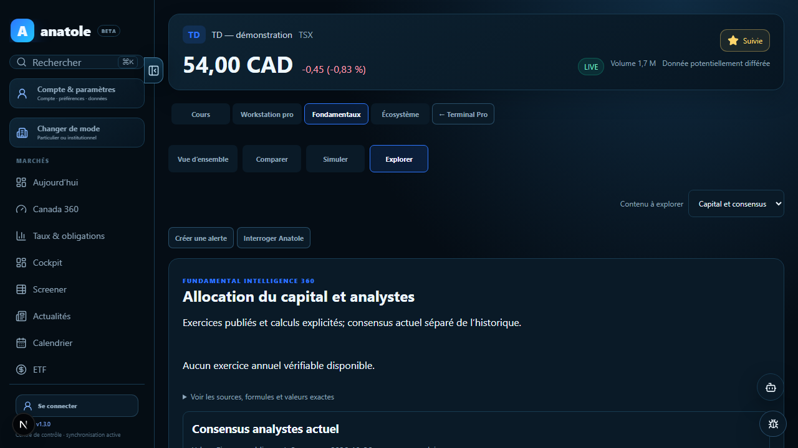
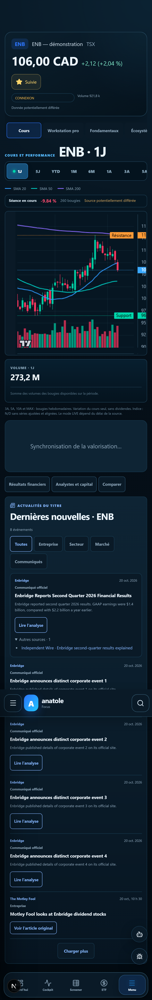
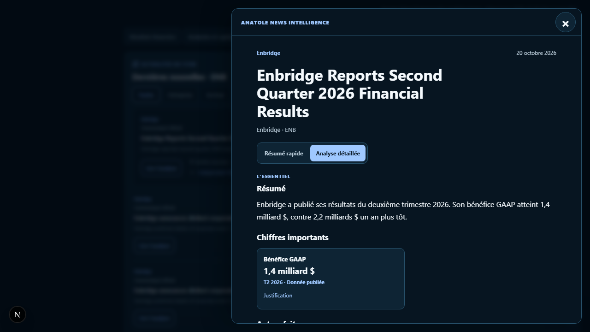
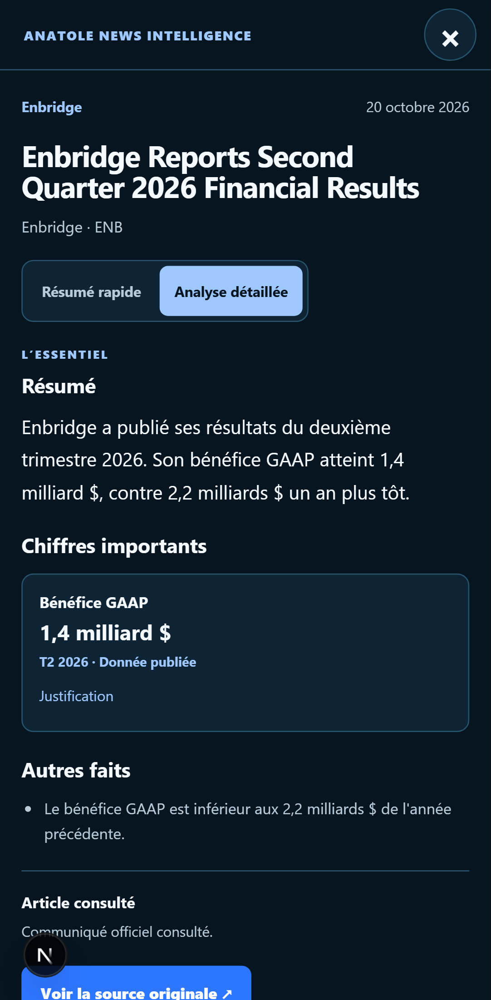
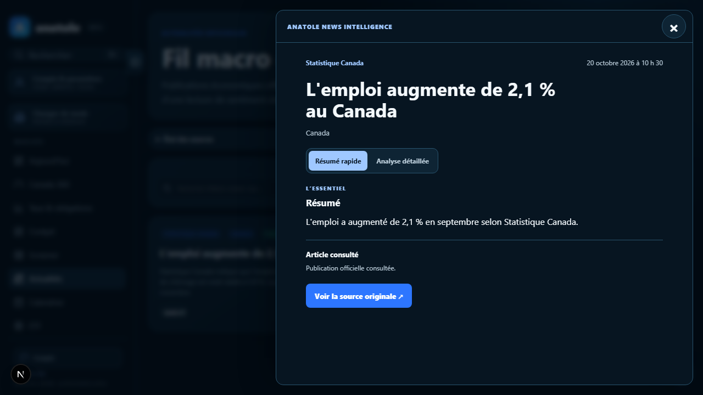
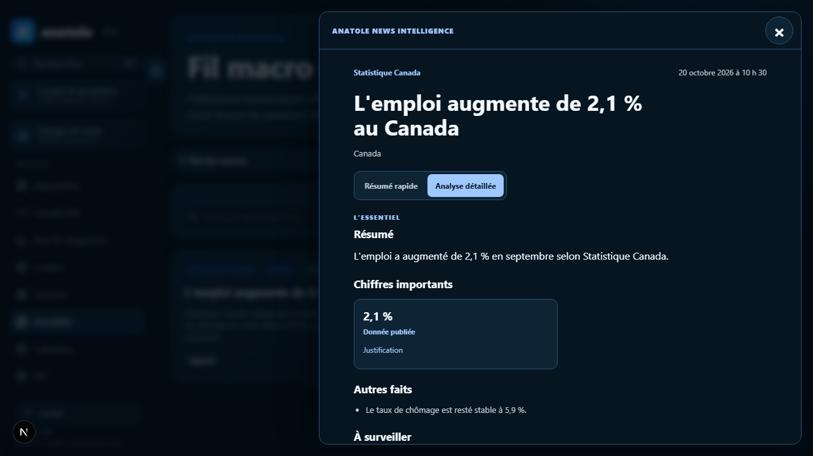

# Focus Intelligence 2.0 — parcours Premium

Cette PR réorganise l’accueil Focus autour du cours, du graphique, de quatre indicateurs essentiels, puis d’un fil éditorial. Les ratios supplémentaires restent dans un panneau repliable ; les états financiers, analystes, comparables et outils avancés restent accessibles depuis la navigation du même titre.

## Avant / après du fil

Les captures ci-dessous proviennent de la **même fixture Playwright ENB**. Elles montrent uniquement la présentation, pas une couverture d’articles vérifiée en production.

| Avant : cartes uniformes | Après : annonce principale et liste compacte |
| --- | --- |
|  |  |

La capture « après » correspond à la pile complète des quatre PR : la synthèse du cours est compacte, le volume observé remplace l’estimation acheteur/vendeur et le fil donne la priorité à une annonce. La nouvelle vue affiche la date, l’éditeur, le sujet et l’image fournie par l’éditeur lorsqu’elle est disponible. Les angles supplémentaires d’un événement sont repliables. Les filtres et « Charger plus » interrogent la pagination de l’API News Coverage de la PR #169. Cette PR Premium est empilée après Résumé+ (#170) et News × Fundamentals (#171).

## Captures de validation visuelle

Les vues ENB et Résumé+ ci-dessous utilisent des fixtures Playwright ; TD provient du parcours local en mode démonstration et affiche explicitement les données partielles renvoyées par les fournisseurs. Ces images documentent l’interface, sans attester la couverture ou la disponibilité des sources en production.

| Focus TD desktop | Focus TD Pixel 7 |
| --- | --- |
|  |  |

| Résultats financiers TD | Analystes et capital TD |
| --- | --- |
|  |  |

| Fil ENB Pixel 7 | Lecteur ENB desktop | Lecteur ENB Pixel 7 |
| --- | --- | --- |
|  |  |  |

| Résumé rapide | Analyse détaillée |
| --- | --- |
|  |  |

## Données et limites

- Le graphique demande les plages 1J, 5J, 1M, 6M, YTD, 1A, 5A et MAX au fournisseur. L’horizon 3A découpe exactement les trois dernières années de la série 5A hebdomadaire ; `10A` reste disponible. MAX représente l’historique renvoyé par le fournisseur ; la démonstration utilise sa plus longue série synthétique.
- Les séries de démonstration sont recalées sur une même dernière cotation pour éviter l’écart visible entre le prix de l’en-tête et celui du graphique lorsqu’on change de période. Cela ne transforme pas ces données synthétiques en prix de marché.
- Le volume présenté est la somme des volumes de bougies disponibles. L’ancienne séparation « acheteur/vendeur » n’était qu’une inférence OHLCV, sans données de transactions bid/ask ; elle n’est plus affichée comme statistique de marché.
- La vue de valorisation privilégie capitalisation, C/B, BPA et rendement du dividende. Les autres ratios restent accessibles à la demande. L’absence de donnée reste `N/D`.
- Les résultats financiers, le consensus, les analystes et les entreprises comparables réutilisent les modules Focus existants. Les liens de navigation internes préservent le titre courant.
- Aucun rendement avec dividendes ni comparaison à un indice n’est calculé à partir de prix non ajustés ou de devises incompatibles. Ces comparaisons demandent des séries datées, ajustées et alignées qui ne sont pas fournies par ce parcours.
- Les sélecteurs CSS Modules sans référence dans les composants actifs ont été supprimés du fil Focus, de l’espace de travail, du terminal d’analyse et du graphique provincial. Les classes construites dynamiquement pour l’observatoire de portefeuille sont conservées. Ce nettoyage permet de garder la pile des quatre PR sous le budget JavaScript existant.

Le PDF Yahoo fourni dans la conversation sert de référence de hiérarchie de l’information. Aucun contenu ou visuel propriétaire n’est repris.
