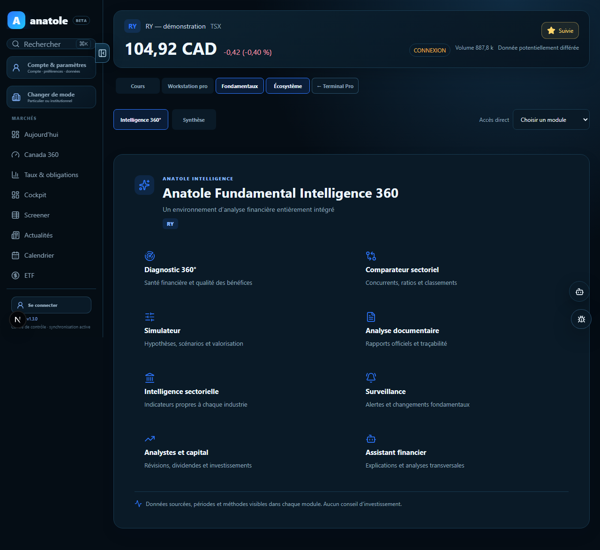
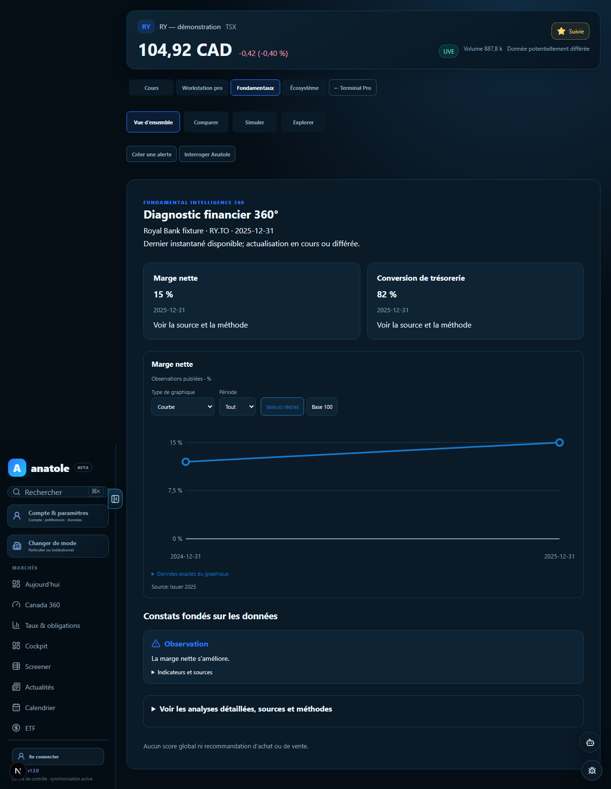
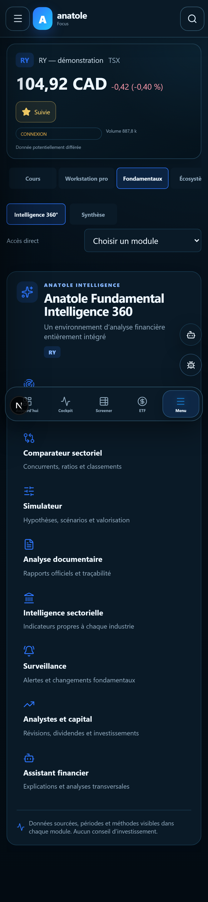
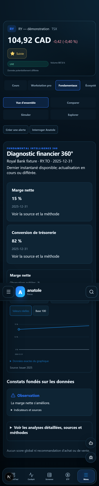
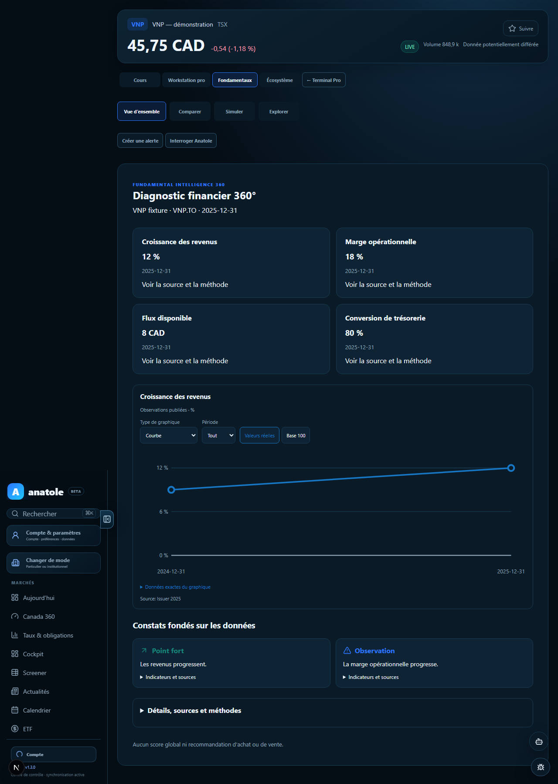
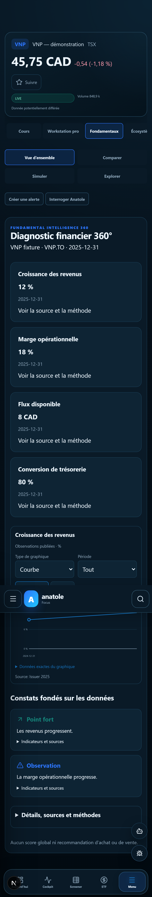

# Fundamental Intelligence 360 V4 — comparaison visuelle

Captures Playwright à largeur desktop et mobile. RY illustre les données partielles ; VNP illustre quatre indicateurs disponibles et leur traçabilité.

| Format | Avant : portail de huit entrées | Après : vue d’ensemble et détails à la demande |
| --- | --- | --- |
| Ordinateur |  |  |
| Mobile |  |  |

| Jeu complet | Vue d’ensemble VNP |
| --- | --- |
| Ordinateur |  |
| Mobile |  |

La navigation passe de huit modules et une seconde sélection à quatre espaces. Le diagnostic affiche d’abord les valeurs disponibles, un historique et les constats. Les indices directionnels, les calculs, les sources et les données manquantes restent accessibles dans les détails. Les captures partielles montrent que les cartes sans valeur ont disparu ; les captures VNP montrent les quatre mesures renseignées.
