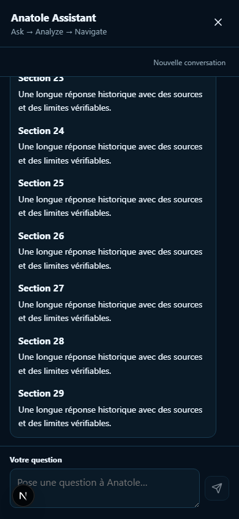
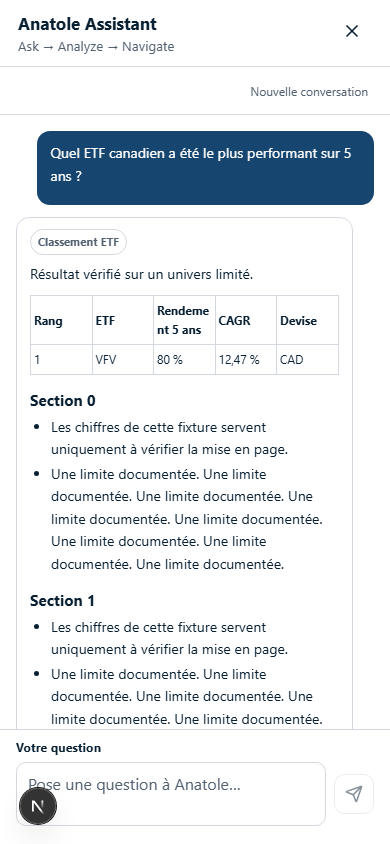
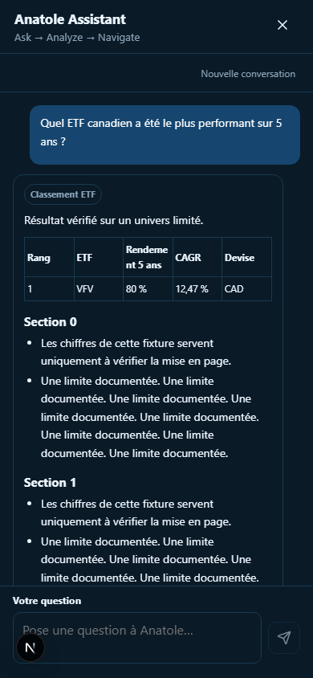

# Assistant UX and historical ETF verification

## Scope and methodology

- The global assistant uses a fixed visual-viewport panel. Only its history scrolls; header and composer do not shrink. Keyboard resize, safe areas, focus restoration, Escape and keyboard focus wrapping are supported.
- New historical intents override page context. A short horizon follow-up retains all compared ETFs; it does not reuse an unrelated page symbol.
- Reuses `EtfHistoryService`, with daily observations in native currency for research. Existing chart conversion and weekly long-range charts are preserved. Adds 3-month and 3-year horizons.
- Price return = `(last close / first close - 1) * 100`. CAGR uses actual days / 365.2425, for horizons around one year or longer. Dividends are excluded; no total-return claim or invented distributions.
- All compared rows use common exact observation dates. Incomplete, sparse, stale-dated, wrong-exchange or incompatible-currency/method data are excluded and explained. Different currency bases are shown without a shared rank. An explicit total-return request is never silently answered as a total-return ranking.
- Canadian ranking sample: XIC, XIU, VCN, VFV, XQQ, ZAG, XBB, XDV from the existing catalogue. US sample: SPY, QQQ, VOO, with official issuer identities in the catalogue module. Every answer explicitly says that this sample is non-exhaustive. Market scope means listing market, not exposure; VFV remains a Canadian-listed ETF.
- A ranking with no specified country asks which listing market to examine. An unsupported horizon requests clarification instead of silently substituting five years.
- Facts and tables are deterministic. LLM synthesis cannot overwrite calculated results, dates or return methodology. Source failure produces missing-data explanations.
- Chat rendering shares the same bounded parser and DOM renderer. Text is inserted using text nodes, never `innerHTML`; tables cannot introduce links or script.

## Captures

All numerical values in UI screenshots are explicitly labelled test fixtures. They are not investment results or production data.

Before (390 × 844):

After, 390 × 844, light and dark:

Other verified dimensions:

- [768 × 1024 light](assistant-768-blue.png), [dark](assistant-768-dark.png)
- [1366 × 768 light](assistant-1366-blue.png), [dark](assistant-1366-dark.png)
- [1440 × 900 light](assistant-1440-blue.png), [dark](assistant-1440-dark.png)

The viewport tests also simulate a 420-pixel visual viewport for the virtual keyboard. Physical iOS/Android keyboards still require device testing; existing mobile WebKit/Chromium journeys cover browser interaction.

## Validation

See the pull request for final counts. Automated coverage includes regional rankings, three-symbol follow-ups, all seven horizons, exact return/CAGR, partial history, upstream failure, currency and exchange verification, daily date semantics, stale cache, and real FastAPI routing. Browser tests cover long answers, tables, scroll retention, close/reopen, reset, viewport bounds and both themes. The JavaScript budget is unchanged.
